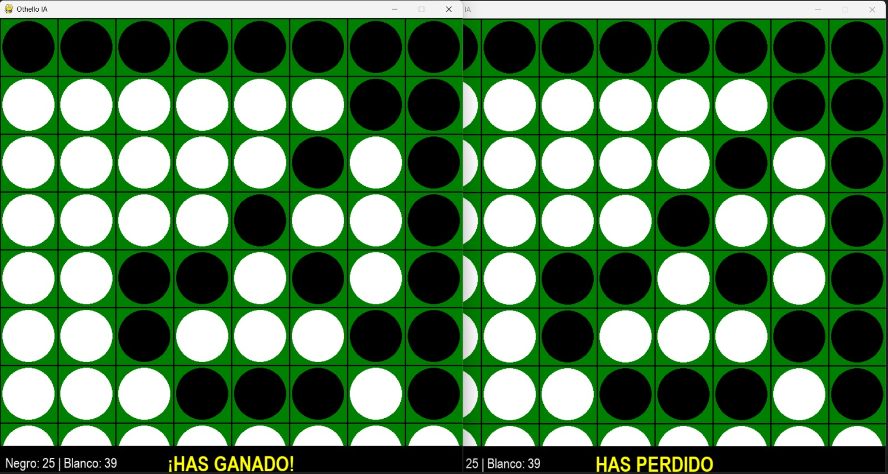
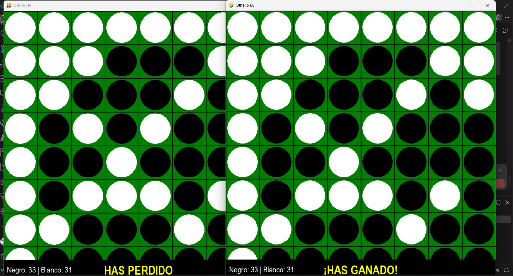
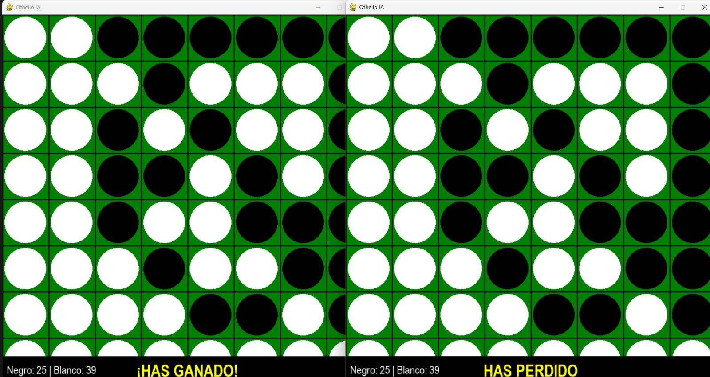

# Competencia externa de Othello

## 6. Descripción de la Competencia; 6.1. Estructura del Torneo; 12.1. Para Othello

Fuente: tabla, aclaraciones y tres capturas aportadas por el usuario. Ispis utilizó **fija, altura 4, Minimax con poda Alpha-Beta en las cinco partidas**. Configuración propia declarada, no comprobada mediante logs. Se desconocen fecha de juego, límite de tiempo, configuración y profundidad rivales. No se midieron tiempos ni nodos; no se dispone de código rival, secuencia de jugadas ni aperturas confirmadas.

| Partida | Rival | Color Ispis | Color rival | Inició* | Fichas Ispis | Fichas rival | Ganador |
|---:|---|---|---|---|---:|---:|---|
| 1 | Equipo Juan Pablo | Negras | Blancas | Ispis | 25 | 39 | Equipo Juan Pablo |
| 2 | Equipo Juan Pablo | Blancas | Negras | Equipo Juan Pablo | 31 | 33 | Equipo Juan Pablo |
| 3 | Equipo Juan Pablo | Negras | Blancas | Ispis | 25 | 39 | Equipo Juan Pablo |
| 4 | Equipo Daniela | Negras | Blancas | Ispis | 49 | 15 | Ispis |
| 5 | Equipo Daniela | Blancas | Negras | Equipo Daniela | 4 | 59 | Equipo Daniela |

*Inicio según tabla y regla de que negras comienza; no se verificó una traza del primer movimiento.

Resumen descriptivo (puntuación victoria/empate/derrota = 1/0.5/0):

| Rival | Partidas reportadas | V/D/E Ispis | Diferencia media Ispis−rival | Puntos Ispis |
|---|---:|---|---:|---:|
| Equipo Juan Pablo | 3 | 0/3/0 | −10.00 | 0 |
| Equipo Daniela | 2 | 1/1/0 | −10.50 | 1 |
| Total | 5 | 1/4/0 | −10.20 | 1 |

La tasa descriptiva de victorias es 20%. Sin incluir P5, cuya terminalidad no se confirmó, los cuatro resultados restantes dan 1 victoria y 3 derrotas y diferencia media +1.00; se explicita esta sensibilidad sin ocultar el resultado reportado de P5. No se dispone del encuentro Juan Pablo–Daniela: esta tabla no representa una clasificación completa de todos contra todos. Los cinco encuentros externos no completan ni se suman al plan interno de 104: sus 19 registros y su análisis se conservan separados.

## 3.1. Reglas Fundamentales; 13. Métodos Estadísticos Requeridos

- P1 y P3 son encuentros reportados por separado, con la misma configuración propia y marcador 25–39. Las capturas muestran distribuciones visibles distintas, pero no permiten reconstruir los inicios ni las secuencias. No se deduplican por marcador ni se asume independencia estadística.
- P5 suma 63 fichas: puede existir final legal con una casilla vacía si nadie puede mover. El usuario no pudo confirmar esa condición y no aportó captura; se registra como resultado reportado con terminalidad no verificada, no como una partida reproducida.
- Las capturas de P1–P3 respaldan los contadores negro/blanco. La atribución de cada color a cada equipo proviene de la tabla, no del rótulo “HAS GANADO” de una ventana: aparecen dos clientes sin identificación de equipo.
- No se calculan p, bootstrap, correlaciones ni una prueba chi-cuadrado sobre estos cinco encuentros: muestra mínima, posible dependencia, rivales heterogéneos y condiciones desconocidas. Tampoco se fabrican tiempos, nodos ni promedios de eficiencia. Los análisis del experimento interno siguen vigentes sólo para sus propios datos.

## 5. Análisis Crítico Requerido; 7. Descripción de Funciones en el Artículo

Los marcadores muestran que Ispis perdió cuatro de cinco encuentros, pero sin las jugadas completas ni la configuración rival no puede identificarse la causa exacta. Como hipótesis de trabajo, la búsqueda a profundidad 4 puede omitir consecuencias más lejanas y la evaluación fija no distingue estabilidad real ni riesgo contextual de conceder esquinas; estas limitaciones podrían influir, pero las capturas no lo demuestran. Para mejorar, conviene registrar y reproducir cada jugada, localizar dónde se deterioran movilidad y acceso a esquinas, contrastar pesos y penalizaciones de casillas adyacentes a esquinas vacías con partidas de prueba separadas, y ensayar mayor profundidad dentro del mismo presupuesto de tiempo. Cada cambio debe evaluarse por separado con aperturas variadas y ambos colores; podría aumentar la competitividad, sin garantizar derrotar a esos rivales.

Estas propuestas son trabajo futuro, no cambios implementados ni estrategias atribuidas a los rivales. No basta afirmar que el rival buscó más profundo o controló mejor las esquinas: no hay evidencia suficiente para establecerlo. Las 19 partidas internas comparaban fija contra etapas; su ventaja interna no predecía el resultado frente a agentes distintos.

## 16. Formato de Tablas y Figuras; 22. Formato de Datos; 23. Política de Integridad Académica

- `registros_externos_othello.json`: datos reportados, desconocidos como null, límites de evidencia y SHA256 de capturas.
- `detalle_partidas_othello.csv`: colores, inicio reportado, configuración propia y notas.
- `resultados_othello.csv`: ocho columnas exactas de la guía, exclusivo de esta carpeta externa. A=Ispis, B=rival; diferencia=A−B. Profundidad rival y tiempos desconocidos quedan vacíos (no cero); de existir tiempos usarían segundos medios por decisión, pero no se midieron. Empate se representaría como `empate`.
- `resumen_externo_othello.csv` y `tabla_externa_othello.tex`: derivados descriptivos. Regenerar desde la raíz con `python -B codigo/othello/Othello-main/analizar_externa_othello.py`.
- Las capturas originales están en `evidencias/`, copiadas sin recorte, anotaciones ni edición; conservan sus nombres. Verificación de copia mediante SHA256. La fuente es el usuario, no un registro automático del motor.
- `articulo/othello/competencia_externa.tex` integra tabla y discusión; `evidencias_competencia_externa.tex` prepara las capturas como apéndice opcional, sin modificar el artículo compartido.

### 16. Formato de Tablas y Figuras: evidencia P1

### 16. Formato de Tablas y Figuras: evidencia P2

### 16. Formato de Tablas y Figuras: evidencia P3

La participación externa queda documentada por resultados reportados y tres capturas. No equivale a un torneo completamente instrumentado ni a validación legal por reproducción. La redacción y el script de resumen recibieron asistencia de OpenAI Codex; los resultados proceden del usuario y no fueron generados por IA.
